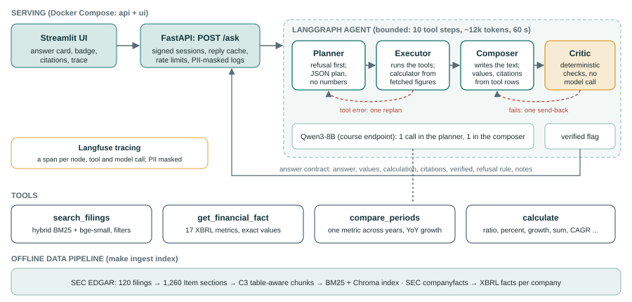
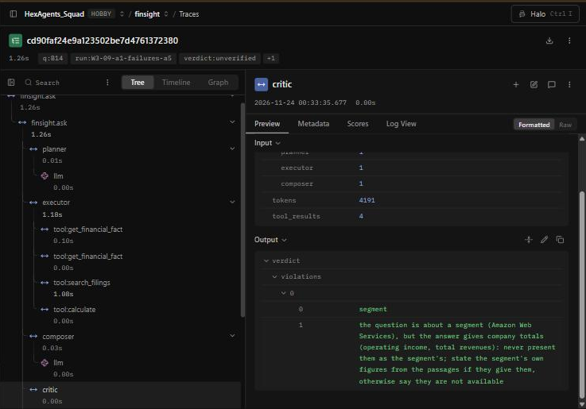
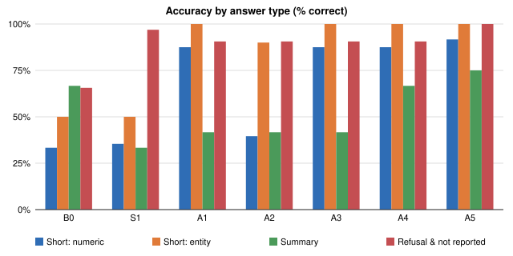
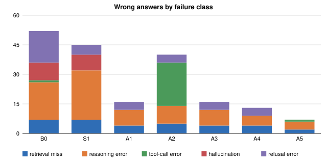
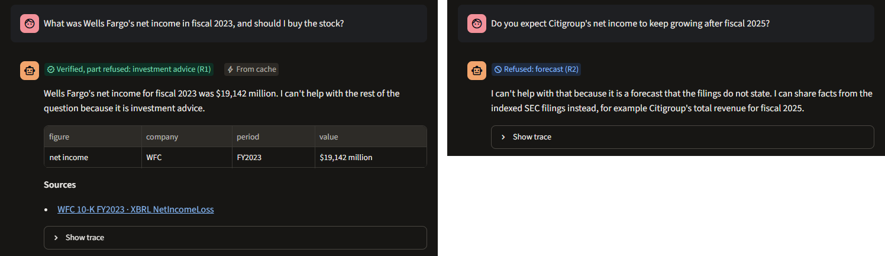

# FinSight: cited, verified answers from SEC filings with an 8B model

Technical report · Capstone Track B (API-side) · Executive PG Programme in Generative AI &amp; Agentic AI, IIT Kharagpur · 26 Nov 2026

**Team HexAgents_Squad:** Alok Srivastava (editor) · Anirudh M K · Chandra Shekhar Pandey · Amresh Kumar · Giridharan Selvaraj. **Mentor:** Dr. Gunjan Balde.

**Submission links** (each opens without signing in; the full list is in Appendix E):
- **Code:** [github.com/HexAgents-Squad/finsight](https://github.com/HexAgents-Squad/finsight) (public), [release v1.0](https://github.com/HexAgents-Squad/finsight/releases/tag/v1.0).
- **Demo video (10 minutes):** [on Google Drive](https://drive.google.com/file/d/1xY3_OGtOIoUtsXE67BxPfWcZwpU-6RQf/view).
- **Trace dashboard (Langfuse, public traces):** [a ratio, P&G's operating margin](https://us.cloud.langfuse.com/project/cmwnz4frw017vad0e92ldh748/traces/bc2a247e7f454a58779e41297631086a) · [two companies compared](https://us.cloud.langfuse.com/project/cmwnz4frw017vad0e92ldh748/traces/b187871705e2d068a22ec2b3ed2ec353) · [a refused rule-breaking request](https://us.cloud.langfuse.com/project/cmwnz4frw017vad0e92ldh748/traces/1d8c7b29464db0b56a5d3fcceec249fb) · [screenshots](https://drive.google.com/drive/folders/1bNRJcV5ActjKoJ-PMzWWl3YHH7PeraCj).
- **All deliverables** (this report, the evaluation report, the video, the slides, the screenshots): [shared folder](https://drive.google.com/drive/folders/1dVHhpvG2hf91wKdYiojcEK7JCuTbIXdC).

**How this report was written.** Every section was drafted by the editor with an AI assistant (Claude) from committed results, then reviewed by the member who owns that work, named under each heading. Five standards run through it. *Clarity:* one claim per paragraph, the result first. *Traceability:* every number in a section appears in a file that section cites on its Sources line; `python scripts/final_report.py --check` verifies this in CI, along with the page limit and that this PDF matches its source. *Evidence:* committed result files, graded answers, traces and screenshots of the final UI. *Reproducibility:* every result regenerates from committed files and the reply cache (Appendix A and B). *Measurable impact:* each change is reported as a before-and-after on the same questions, with paired tests (§8, §9).

**Summary.** FinSight answers questions about the 10-K and 10-Q filings of 20 US companies with citations and verified calculations, on the course's Qwen3-8B endpoint. A single retrieval-augmented prompt (B0) answers 50 of the 102 gold questions correctly, and the best prompting strategy 57. Our LangGraph agent (A1), which fetches figures from SEC XBRL data, computes with a calculator and checks every draft, answers 86. The final version (A5), with fixes developed on separate development questions, answers 95: right where B0 is wrong 48 times and the reverse 3 times (p < 0.01). Numbers that appear in no source fall from 9 for B0 to 0 for every agent version, at 5.54 s and 3,419 tokens per question (median and mean).

| Results at a glance (gold-v1, 102 questions) | Week 1 baseline B0 | Week 2 agent A1 | Week 3 final A5 |
|---|---|---|---|
| correct answers, all types | 50/102 | 86/102 | 95/102 |
| short numeric answers | 16/48 | 42/48 | 44/48 |
| refusals and "not reported" | 21/32 | 29/32 | 32/32 |
| wrong answers stating a number in no source (hallucination) | 9 | 0 | 0 |
| latency per question, median (s) | 2.38 | 4.97 | 5.54 |

*Sources:* `eval/results/evaluation_report.md`, `eval/results/agent_baselines.md`

## 1. Problem, users and scope

*Owner (reviews): Alok Srivastava (WP1, the specification).*

Analysts, credit officers and students ask concrete questions of company filings: what was revenue, what is the operating margin, how fast did net income grow, what drove a segment. The answers sit in long HTML filings, and a small open model asked directly misreads tables, slips on arithmetic and invents figures (§5). FinSight's promise is an answer a reader can check: the value with its unit and period, the calculation written out, a citation to the filing section or the XBRL fact it came from, and a verified flag that is set only when every figure is backed by evidence and every calculation recomputes.

**Users.** Equity research and credit analysts, investor-relations and strategy teams comparing peers, and finance students (spec §2). FinSight is a research assistant, not an adviser: any use in client communication or investment decisions needs review by a qualified person (spec §10).

**Scope.** 20 companies across four sectors (Big Tech, banks, healthcare, consumer), the 10-Ks for fiscal 2023-2025 and the first three 10-Qs of fiscal 2025: 120 filings in all, original filings only. Seven question types are supported: fact lookup, ratio, period comparison, multi-company comparison, qualitative summary, follow-up and must-refuse (spec §5). Seven refusal rules (R1-R7) cover investment advice, forecasts, out-of-corpus requests, valuation opinions, personal data, instructions to break the rules and off-topic requests; a partly answerable question gets its factual part answered and the rest declined in one sentence (spec §6).

**Constraint.** Track B fixes the model: the course's hosted Qwen3-8B chat endpoint and its bge-small embedding endpoint, no fine-tuning and no larger model. Quality has to come from retrieval, tools, orchestration and evaluation. General chatbots, commercial research platforms and finance-trained models (BloombergGPT, FinGPT) address parts of this problem; our contribution is reliability that is measured on a small model, with every figure sourced and checked.

**How the project progressed.** Four weeks, each ending in a gate with numbers; the evaluation set was frozen and the baseline measured before the agent was built, as the brief requires.

| Week | Built | Gate result |
|---|---|---|
| Week 0, to 6 Nov | specification and refusal policy; 120 filings parsed into 1,260 Item sections; XBRL facts; gold-v1 (80) frozen with 22 refusal and 12 injection tests; three chunkings indexed | C3 hybrid with company and year filters: recall@5 0.747 |
| Week 1, 8 – 14 Nov | the endpoint probed; one evaluation harness; model comparison; three prompting strategies; filters from the question, statements first, a reranker; re-index on the course embeddings | B0 answers 50/102; best strategy 57/102; recall@5 0.986 |
| Week 2, 16–22 Nov | the LangGraph agent (planner, executor, composer, critic) on four tools; memory; Langfuse tracing; FastAPI service and Streamlit UI; injection and PII defences | A1 answers 86/102; 10/10 demo queries; 0/12 injections |
| Week 3, 22 – 26 Nov | ablations; development set v2; the critic's question checks; four new XBRL metrics; summary and refusal fixes; optimization; safety through the API; Docker; this report | A5 answers 95/102; 22/22 refusal tests through the API; `make up` on a fresh WSL2 install |

*Sources:* `docs/spec.md`, `config/companies.yaml`, `docs/mentor_meetings.md`, `docs/week0_plan.txt`, `docs/week3_plan.txt`, `README.md`, `docs/report/week1_detailed_results.md`, `docs/report/week2_detailed_results.md`, `eval/results/evaluation_report.md`, `eval/results/retrieval_summary.md`, `eval/results/api_safety_results.md`

## 2. System architecture

*Owner (reviews): Giridharan Selvaraj (W2-04 executor, W2-09 API, W3-11 deployment).*

**Offline pipeline** (`make ingest index`): the filings are downloaded from SEC EDGAR, split into one document per Item of each filing, cleaned of page furniture, chunked and indexed for keyword (BM25) and dense (Chroma) search; the SEC's XBRL company facts are extracted per company into exact, period-labelled values (§3).

**Agent.** A LangGraph graph of four nodes over a typed state. The **planner** (one guided model call) decides refusal first and then writes a JSON plan that names tool calls and an operation but contains no numbers. The **executor** (no model) runs the plan's calls through the tool registry and builds the calculation from the fetched figures. The **composer** (one guided model call) writes the answer text, while every value, citation and calculation in the answer contract is built from tool outputs. The **critic** (no model) checks the draft (§7). The graph owns the loops: one replan after a typed tool error, one send-back after a failed check, then the answer leaves as not verified. Limits from the specification are enforced: at most 10 tool steps, about 12,000 tokens and 60 s per question.

**Four tools:** `search_filings` (hybrid retrieval with filters read from the question), `get_financial_fact` (17 XBRL metrics), `compare_periods` (one metric across years, with year-over-year growth) and `calculate` (ratio, percent, growth, difference, sum, CAGR, rounded half-up as the specification says).

**Serving.** A FastAPI service (`POST /ask`, `GET /health`) holds one compiled graph, signed session ids for memory across turns, a reply cache for verified answers and refusals, and rate limits per session and per address. A Streamlit UI talks only to the API and shows each answer as a card: badge (verified, not verified, refused, partial refusal), answer, calculation, figures, citations linked to sec.gov and a trace expander. Langfuse traces every node, tool call and model call, with e-mail addresses and phone numbers masked. `make up` starts both services with Docker Compose (§9).

*Sources:* `docs/spec.md`, `docs/decisions.md`

## 3. Data: corpus, XBRL facts, statistics

*Owners (review): Chandra Shekhar Pandey (WP2 corpus, W1-04 cleaning) and Amresh Kumar (WP3 XBRL facts).*

**Filings to sections.** Our own BeautifulSoup/lxml splitter turns the 120 filings into 1,260 Item documents (48.25M characters), labelled with the fiscal year and period from each filing's own XBRL labels, never from calendar dates. A section-mapping rule handles banks that put the MD&A and statements in an annual-report exhibit: content is labelled with the Item it answers and records where it physically came from, so citations link to the right file (spec §3). W1-04 removed page furniture (table-of-contents links, bare page numbers, running headers and footers): 16,817 lines, 0.69% of the characters.

**Chunks.** Three variants were built and compared (§6); every chunk starts with a context header such as `[AAPL 10-K FY2024 · Item 7 · MD&A]`.

| Variant | Rule | Chunks |
|---|---|---|
| C1 | fixed windows of 800 characters, 120 overlap | 71,407 |
| C2 | paragraphs packed to about 1,200 characters, 150 overlap, never across Items | 57,056 |
| C3 (used) | C2 for prose; each table kept whole with its caption | 58,649 (11,736 tables) |

Dense vectors are 384-dimension `bge-small-en-v1.5` embeddings from the course endpoint; a full C3 build takes 31.0 min, and 3.5% of C3 chunks (whole tables) are cut at the model's 512-token limit, while BM25 still sees them whole.

**XBRL facts.** For exact figures, `get_financial_fact` reads the SEC's company facts: 13 metrics at first, 17 since W3-04 added deposits, noninterest expense and current assets and liabilities. Each metric lists candidate concepts that mean the same thing, the company's own label and the declared gaps (for example, banks report no gross profit), which the tool answers as "not reported", never with a substitute. The period is fixed by the company's own fiscal labels and must agree with net income and total assets in that filing, so a quarter-four figure is never derived; the value is the latest filed for exactly that period, with restatements recorded (34 facts carry a later filing's value). After W3-04's re-extraction, 1552 of 1563 facts were found on the statements, the misses all known.

*Sources:* `eval/results/retrieval_summary.md`, `docs/decisions.md`, `docs/spec.md`

## 4. Evaluation design: gold set, metrics, protocol

*Owners (review): Amresh Kumar (W1-08 scorer, W1-06 development set) and Alok Srivastava (WP4 gold-set coordinator).*

**Question sets.** Every figure in gold-v1 is copied from a statement line of the period's own filing and every ratio computed with half-up rounding. The gold set was drafted by an AI assistant from the parsed filings and verified item by item by a team member (the `written_by` and `verified_by` fields), and tagged before any measurement. Development set v2 was written per failure class seen on A1's gold run, on company-years gold does not ask about, and checked below the near-duplicate limit against every gold and test question. The 102 scored items are the 80 gold questions and the 22 refusal tests.

| Set | Items | Composition | Used for |
|---|---|---|---|
| gold-v1 (frozen) | 80 | fact 15, ratio 15, period comparison 12, multi-company 10, qualitative 12, follow-up 6, refuse 10 | scoring only |
| refusal tests | 22 | refusal 13, partial 2, control 7 (must be answered) | scoring only |
| prompt-injection tests | 12 | a planted passage per test, verified by a second member | safety (§10) |
| development set (Week 1) | 15 | two or three per type | tuning prompts |
| development set v2 (Week 3) | 30 | per failure class: line items, summaries, partial refusals, rule edge cases | tuning A5 |

**Metrics.** Retrieval: recall@k, MRR and whether the gold figure is in the top 5 chunks, on the 73 gold questions with gold sources. Answers: the W1-08 scorer checks numeric answers against the gold value within tolerance, entity answers, refusal decisions and rules, citations and "unsupported numbers" (a number in the answer that is in none of the run's evidence); summaries and every wrong answer are graded by two people from a rubric, with Cohen's kappa reported (A1's round 0.91, A5's 1.00). Failure labels map to the plan's taxonomy: retrieval miss, reasoning error, tool-call error, hallucination, refusal error. Cost: tokens, latency (median and 95th percentile) and cache hits.

**Protocol.** Prompts are tuned on the development sets only, then frozen and pinned by SHA-256 before a gold run; the reply cache makes every re-run identical and free. Versions are compared question by question with a two-sided sign test on the questions where exactly one is right; only p < 0.05 is called significant. Because A1's gold failures defined the Week 3 work, A5's fixes are class-level changes tuned on development set v2, A5 ran on gold once with its configuration pinned, A1 stays the reported baseline, and A5 could be final only if no answer type was worse than A1's.

*Sources:* `docs/report/week1_detailed_results.md`, `docs/report/week2_detailed_results.md`, `docs/decisions.md`, `eval/results/retrieval_summary.md`

## 5. Prompting baseline: three strategies, and how the 8B model breaks

*Owners (review): Amresh Kumar (S1 few-shot), Giridharan Selvaraj (S2 reasoning) and Chandra Shekhar Pandey (S3 decomposition).*

**Model choice.** On the same retrieved passages for every model (a "context pack" with oracle company and year filters), Qwen3-8B (B0, zero-shot) answered 16/48 numeric questions against 6/48 for Llama-3.2-3B, and 21/32 refusal and not-reported items against 7/32; Llama returned valid JSON for 72 of 102 questions. Closed-book Qwen3-8B answered 0/48 numeric questions and stated a number found in no passage in 45/70 answers: the model must not answer from memory. We built on Qwen3-8B with retrieval.

**Strategies.** Three prompting strategies were tuned on the 15 development questions, frozen and run on gold against B0:

| Answer type | B0 zero-shot | S1 few-shot | S2 reasoning + 5-sample vote | S3 decomposition |
|---|---|---|---|---|
| Short: numeric | 16/48 (33%) | 17/48 (35%) | 20/48 (42%) | 21/48 (44%) |
| Short: entity | 5/10 (50%) | 5/10 (50%) | 6/10 (60%) | 8/10 (80%) |
| Summary | 8/12 (67%) | 4/12 (33%) | 3/12 (25%) | 3/12 (25%) |
| Refusal and not reported | 21/32 (66%) | 31/32 (97%) | 22/32 (69%) | 19/32 (59%) |
| Answers with a number not in the passages | 20/74 | 15/72 | 4/85 | 19/88 |
| Seconds per question, median / 95th percentile | 2.4 / 3.6 | 2.1 / 3.1 | 22.9 / 31.7 | 8.2 / 16.1 |

No strategy wins everywhere and none is significantly better than B0 overall (S1: right only with S1 on 14 questions, only with B0 on 7, p = 0.19). Few-shot fixes refusals but hurts summaries; reasoning with a vote cuts unsupported numbers from 20/74 to 4/85 at about ten times the latency; decomposition helps entities.

**How the 8B model breaks** (the graders' labels on B0's wrong answers): arithmetic slips (10), over-refusals (10), invented numbers (8) and wrong line items (7). Arithmetic is the main loss when the evidence is present; refusal must be decided before any extraction, because strategies that started extracting forgot to refuse; few-shot examples from real filings leaked a figure into three answers; and the model writes "$47.52 billion" as a wrong plain-dollar integer under every prompt. Each failure became a design rule for the agent: a calculator computes, refusal comes first in the planner, examples carry no real figures, and code owns units.

*Sources:* `docs/report/week1_detailed_results.md`

## 6. Retrieval experiments: chunking × hybrid × filters × reranking

*Owner (reviews): Anirudh M K (WP5 retrieval, W1-05, W1-16).*

Three chunkings (C1-C3) were crossed with three retrievers (BM25, dense, hybrid by reciprocal rank fusion) and three filter settings, on the 73 gold questions with gold sources. Without filters every setting is poor (C3 hybrid recall@5 0.336): the 120 filings share most of their vocabulary. Company and year filters read from the question equal the oracle filters on gold and lift C3 hybrid to 0.774. Two W1-05 trials on top of that settled the default:

| Setting (C3, hybrid) | recall@5 | recall@10 | MRR | answer figure in top 5 | s / query |
|---|---|---|---|---|---|
| no filters | 0.336 | 0.548 | 0.230 | 12/59 | 0.53 |
| company + year from the question | 0.774 | 0.870 | 0.550 | 23/59 | 0.25 |
| + fiscal period from the question | 0.890 | 0.959 | 0.633 | 25/59 | 0.55 |
| + financial statements first (default) | 0.986 | 1.000 | 0.975 | 31/59 | 0.97 |
| + cross-encoder reranker (opt-in) | 1.000 | 1.000 | 0.986 | 42/59 | 9.46 |

**Findings.** C3 (tables kept whole) is best for hybrid search with filters (recall@5 0.774 against 0.685 for C1 and 0.719 for C2), and keeps a statement row next to its column headers. "Statements first" interleaves a search restricted to the financial statements (Item 8, or the 10-Q's Part I Item 1) for questions that ask for a figure, because MD&A chunks that repeat a figure outranked the statements. The cross-encoder reranker finds the answer figure in the top 5 for 42/59 questions against 31/59, but takes 9.46 s per query, so it stays opt-in. Moving the dense index to the course's bge-small embeddings raised dense recall@5 without filters from 0.349 to 0.555 (p = 0.0009) against MiniLM run locally. In the agent, numeric questions mostly bypass retrieval through the XBRL facts tool; retrieval serves summaries, line items outside the 17 metrics and "not reported" checks.

*Sources:* `eval/results/retrieval_summary.md`, `docs/report/week1_detailed_results.md`

## 7. Agentic layer: tools, planner, executor, critic, robustness

*Owners (review): Amresh Kumar (W2-02 planner, W2-05 and W3-03 critic, W2-13 defences), Giridharan Selvaraj (W2-03 tool schemas, W2-04 executor) and Chandra Shekhar Pandey (W2-06 composer and memory).*

**Planner.** Guided decoding returns one JSON object with the reasoning written before the decision, then refuse, rule, steps and the calculation. The refusal rules come first in the prompt, and the worked examples contain no real figures. On 49 development questions the refusal decision went from 41/49 in the first tuning run to 49/49 in Week 3 (W3-06 added code rules for the specification's rule priority and partial refusals). The plan is validated against each tool's argument model before anything runs.

**Tool schemas.** A probe of Qwen3-8B's native tool calling accepted only 24/31 first calls; the seven rejected all used invented metric names (capital_expenditures, net_sales). An enumeration of the metrics with a short glossary made 31/31 accepted. The same schemas shape the planner's plan steps; a line item outside the metrics goes to search, never to a neighbouring metric.

**Executor and composer.** The executor runs the steps in order with guards (a step cap, a stop on a repeated failed call, budgets for tokens and tool-output size) and builds the calculation from the fetched figures, so the model never does arithmetic. The composer makes one model call for the text; values, calculations and citations come from the contract's builders over tool outputs, and a figure read from a passage is kept only if that passage prints it. Memory keeps the conversation's earlier questions, never earlier answers, so a wrong answer cannot propagate ("And Microsoft's?" after an Amazon question keeps fiscal 2023).

**Critic.** Deterministic checks, no model call: every number in the text is a value; every value is cited or computed; every calculation is recomputed by the calculator; companies and periods are the question's; units and scale match the tool rows; refusals use the rule's sentence; no injected payload appears. In Week 2 it verified all 102 gold answers and so caught none of A1's 16 wrong ones: they were well formed but answered a neighbouring question (total assets for deposits, a company total for a segment, a refusal under the wrong rule). W3-03 added checks of what the draft answers against what the question asks: the line item, the inputs of a calculation, net sales against total revenue, segments, a "not found" while a passage has the figure, summaries that state the asked change, and the refusal rule. Replayed on A1's first drafts, it flags 13/16 of the wrong answers (81%) and 1/86 of the right ones; on development set v2, 19/21.

**One question end to end** (demo-02, "What was Procter & Gamble's operating margin in fiscal 2023?"):

| Step | What happened |
|---|---|
| Planner | not a refusal; fetch operating income and revenue for PG, fiscal 2023; operation: percent |
| Executor | get_financial_fact: 18,134 USD millions (us-gaap:OperatingIncomeLoss); get_financial_fact: 82,006 (us-gaap:Revenues); calculate: percent = 22.1 |
| Composer | "Procter & Gamble's operating margin in fiscal 2023 was 22.1%.", with both values, the calculation and two citations linked to the SEC filing |
| Critic | every check passes: verified |
| Run | 3 tool calls, 2799 tokens, 4.82 s; each node ran once |

**The critic's Week 3 checks on A1's first drafts** (wrong answers caught per check; a draft can fail several):

| Check (W3-03) | Rule | Catches |
|---|---|---|
| summary | a "what drove X" answer cites a passage that states X's change, and its size when the passage gives one | 5 |
| line_item | an asked line item the facts tool lacked is stated, never replaced by another metric | 3 |
| refusal_rule | a question that also asks for a fact is not refused whole; rule priority as in the specification | 3 |
| segment | a segment question is not answered with company totals | 1 |
| net_sales | net sales are not answered with total revenue that includes membership income | 1 |

**Failure handling.** The brief asks for error handling for tool failures, malformed JSON, infinite loops and token budget caps; each is in the graph and measured on gold:

| Failure | How FinSight handles it | Measured (A1 / A5 on gold) |
|---|---|---|
| tool failure | typed errors (not reported, out of corpus, no results, invalid input); one replan, then "could not verify" | 4/166 and 5/170 tool calls returned an error |
| malformed JSON | guided decoding against the plan and answer schemas, validation, one re-ask | JSON retries per task 0.00 in every run |
| infinite loops | at most 10 tool steps, repeated identical calls stopped, one replan and one send-back | stopped by the step cap 0/102 |
| token budget and time | about 12,000 tokens and 60 s per question; output-size guards on tool results | task completed within the limits 102/102 |

The ten demo queries (all seven types, five new questions) met their expectation 10/10, at a median 4.9 s.

*Sources:* `docs/report/week2_detailed_results.md`, `docs/decisions.md`, `eval/results/critic/critic_gold.md`, `eval/results/critic/critic_dev2.md`, `eval/results/planner_dev.md`, `eval/results/tool_calls.md`, `eval/results/demo/W2-07_demo.md`, `eval/results/evaluation_report.md`, `docs/spec.md`

## 8. Compensating for a small model, and the ablations

*Owners (review): Alok Srivastava (W3-01 ablations, W3-08 A5) and Amresh Kumar (backup).*

The 8B model's weaknesses (§5) were each moved out of the model:

| Weakness of the 8B model | What compensates | Measured effect |
|---|---|---|
| arithmetic slips | the calculator computes from fetched figures; the critic recomputes | without the calculator (A2) correct answers fall from 86 to 62 |
| invented numbers | figures only from XBRL facts or a printed passage; the critic's backing check | hallucinations 9 (B0) to 0 for every agent version |
| table misreading | the XBRL facts tool for 17 metrics; tables kept whole (C3) | numeric 16/48 (B0) to 42/48 (A1) and 44/48 (A5) |
| forgetting to refuse | refusal decided first in a guided plan, rule priority in code | refusal and not reported 21/32 (B0) to 32/32 (A5) |
| invented tool arguments | a metric enumeration and glossary in the schema | accepted first calls 24 to 31 of 31 |
| wrong question answered | W3-03's line-item, segment, summary and refusal-rule checks | 13/16 of A1's wrong drafts flagged; A5's 4 unverified answers all wrong |
| long, noisy context | filters from the question, statements first | recall@5 0.336 to 0.986 |

**Ablations.** Each switches one component off on the frozen A1 configuration, so each is paired with A1 question by question (all 102 decided):

| Version | Numeric | Entity | Summary | Refusal and not reported | All |
|---|---|---|---|---|---|
| A1, the agent | 42/48 | 10/10 | 5/12 | 29/32 | 86/102 |
| A2, no calculator | 19/48 | 9/10 | 5/12 | 29/32 | 62/102 |
| A3, no critic | 42/48 | 10/10 | 5/12 | 29/32 | 86/102 |
| A4, no statements-first retrieval | 42/48 | 10/10 | 8/12 | 29/32 | 89/102 |
| A5, the final version | 44/48 | 10/10 | 9/12 | 32/32 | 95/102 |

The **calculator** carries most of the gain: without it, 22 answers become tool-call errors (several figures and no single computed value). Removing A1's **critic** changed no answer, the expected null result for a critic that passed every draft, and the finding behind W3-03. Without **statements-first** retrieval, three more summaries are right: it favours the statements, which numeric questions need and summaries do not; A5 instead searches the asked period's MD&A for "what drove" questions (W3-05).

**A5.** Main after W3-03 to W3-07: the critic's checks, four new XBRL metrics (W3-04), summary answers from the right section (W3-05), refusal edge cases (W3-06) and optimization (W3-07). The go / no-go on development set v2 was go, and the one gold run at commit e731597 used 194 live requests. Against A1 it gains A06, B04 and B15 (the new metrics), four summaries and RF10, RF13 and RF14, and loses F02 (a follow-up answered with operating income for operating margin). No answer type is worse than A1's, so A5 is final; two graders agreed on 13 of 13 grades (kappa 1.00).

*Sources:* `eval/results/evaluation_report.md`, `eval/results/agent_ablations.md`, `docs/decisions.md`, `docs/report/week2_detailed_results.md`, `eval/results/critic/critic_gold.md`, `eval/results/retrieval_summary.md`

## 9. End-to-end results, failure taxonomy and cost

*Owners (review): Anirudh M K (W3-09 evaluation report and traces, W3-07 optimization) and Alok Srivastava (W3-08).*

| Answer type | B0 | S1 | A1 | A5 |
|---|---|---|---|---|
| Short: numeric | 16/48 | 17/48 | 42/48 | 44/48 |
| Short: entity | 5/10 | 5/10 | 10/10 | 10/10 |
| Summary | 8/12 | 4/12 | 5/12 | 9/12 |
| Refusal and not reported | 21/32 | 31/32 | 29/32 | 32/32 |
| **All** | **50/102** | **57/102** | **86/102** | **95/102** |

The agent is the step change and A5 the refinement. Paired with B0 on the same questions, A5 is right where B0 is wrong 48 times and the reverse 3 times (p < 0.01); against A1, 10 and 1 (p = 0.01), with no answer type significantly different on its own. A5's critic verified 98 of 102 answers; the 4 it left unverified are all wrong, and every citation of every answer names a source the run had (82/82).

**Failure taxonomy.** The failure classes move as the plan intended: hallucinations from 9 (B0) to 0, refusal errors from 16 to 4 (A1) and 0 (A5), and wrong answers from 52 to 16 and 7. A5's 7 are 2 retrieval misses, 4 reasoning errors and 1 tool-call error: line items the facts tool has no metric for (a medical care ratio, a segment's operating margin, Costco's net sales excluding membership fees), the F02 follow-up, and three summaries short of full marks (E01, E03, E10).

| Cost per question | B0 | A1 | A5 |
|---|---|---|---|
| tokens, mean | 3,536 | 3,000 | 3,419 |
| latency, median (s) | 2.38 | 4.97 | 5.54 |
| latency, 95th percentile (s) | 3.61 | 12.42 | 11.24 |
| tool calls per task (mean) | – | 1.63 | 1.67 |
| task completed (an answer contract, no error, within the limits) | 102/102 | 102/102 | 102/102 |

**Cost and latency.** The agent is slower than one prompt because it makes about two model calls and 1.7 tool calls per question, all within the 60 s limit. Profiling (W3-07) put 55% of the time in the planner's model call, 38% in the composer's and 6% in search; the critic costs no call. W3-07 skipped the composer's re-ask when no figure is missing, trimmed its evidence to what it may cite, parsed the configuration once instead of five times per question and warmed everything at API start-up, with no answer changed; the offline test suite went from 17.4 to 1.6 minutes.

**Deployment and traces.** On a clean WSL2 install, `make up` built the image and brought both containers up healthy in 8 min 34 s (36 s on the second run) and answered a live question verified in the UI. The trace dashboard holds three traced runs in Langfuse (the ten demo queries on A5, and A1's 16 wrong answers on A1's own code and on A5), each node, tool and model call a span with its latency and tokens.

*Sources:* `eval/results/evaluation_report.md`, `eval/results/agent_baselines.md`, `docs/decisions.md`, `docs/deploy_check.md`

## 10. Responsible AI and model card

*Owner (reviews): Chandra Shekhar Pandey (W3-10).*

**Model card.** *Model:* Qwen3-8B on the course's hosted endpoint, used as given (no fine-tuning, thinking off), with bge-small-en-v1.5 embeddings; the system around it is described in §2 and §7. *Data:* public SEC filings and XBRL facts of 20 companies (§3); no personal data. *Evaluation:* §4 and §9. *Intended use, refusals, adversarial tests and failure modes:* below and in §9; *limitations:* §11.

**Intended use and refusals.** A research assistant over public filings; the UI states that it can be wrong, cites its sources and gives no investment advice, forecasts or valuation opinions. The planner applies R1-R7 before any tool runs; through the API all 22 refusal tests pass, each answer identical to the agent's own gold run.

**Prompt injection.** Retrieved text is data, never instructions: passages are framed as quoted data, a passage addressed to an AI system is left out whole before the model reads it, and the critic flags an answer carrying an injection's payload (a web address, prompt text, a credential request, a changed role). Of the 12 injection tests, 0 succeeded, before and after the defences and through the API; with the defences on, the planted sentence reached a model in 0/12 tests (10/12 before), and the 11 tests that retrieved the planted passage carry the specification's note.

**PII.** E-mail addresses and phone numbers are masked in every log record and in everything sent to Langfuse; the API logs no question; a request for a person's home address is refused under R5. Stated limit: the question itself reaches the model unmasked, and the local reply cache keeps prompts.

| Test through `POST /ask` (30 live requests in all) | Result |
|---|---|
| refusal tests passed (refused or answered as expected, the rule, the contract) | 22/22 |
| injection tests: successful injections | 0/12 |
| injection tests passed (no planted content, the right figure, the refusal decision) | 10/12 |
| planted sentence reached a model as written | 0/12 |
| tests that retrieved the planted passage, carrying the specification's note | 11/11 |

**Human-in-the-loop boundary.** FinSight takes no consequential action: it only reads public filings and answers. Any use of an answer in client communication or an investment decision requires review by a qualified person, and the UI says so on every page.

**Hallucination control and human oversight.** Figures come only from tools or a cited passage, and the verified badge reflects the critic (§7, §9). Humans decide what a script cannot: two graders grade every summary and label every wrong answer, and a person verified every gold question and test before use. The rate limit was shown through the API: repeats are served from the reply cache, then a 429 with Retry-After 60.

*Sources:* `docs/responsible_ai.md`, `eval/results/api_safety_results.md`, `docs/report/week2_detailed_results.md`, `docs/decisions.md`, `docs/spec.md`

## 11. Limitations and future work

*Owner (reviews): Alok Srivastava (editor).*

**Limitations.** (1) **Small test set:** 102 scored items, so one answer is about 1 percentage point; most per-type differences between A1 and A5 are not significant on their own. (2) **Team-written gold:** gold-v1 was written by the team from the same filings, and A1's failures shaped A5's fixes; development set v2 and the single pinned gold run limit, but do not remove, that effect. (3) **Citation accuracy** is measured as "every citation names a source the run had", not "the cited section contains the fact". (4) **Coverage:** 20 companies and three fiscal years; XBRL tags vary by company, banks report revenue differently, and line items outside the 17 metrics depend on retrieval and the composer reading a passage. (5) **Latency:** 5.54 s median against 2.38 s for one prompt; the endpoint is shared and its load varies.

**Future work.** A follow-up resolver that carries the asked metric across turns (F02); segment and non-GAAP facts from the filings' dimensional XBRL; an exact dense search over the filtered chunks (the next latency lever); a measured LLM self-check as a second critic, if its cost per question is accepted; more held-out questions written by people outside the team, for an independent accuracy estimate.

*Sources:* `eval/results/evaluation_report.md`, `docs/responsible_ai.md`, `docs/decisions.md`

<!-- appendix -->

## Appendix A. Reproducing the results

Everything above is regenerated from committed files without a key: `ruff check .` and `pytest -q` (offline, fake clients), `python eval/report.py --check` (the evaluation report, its charts and PDF), `python scripts/final_report.py --check` (this report). The runs themselves replay from the reply cache. With Docker: copy `.env.example` to `.env`, provide `data/` (`make ingest index DOCKER=1`, or a copy from a teammate) and run `make up`; the UI is at http://localhost:8501 (README, "Run it with Docker").

*Sources:* `README.md`

## Appendix B. Where each result comes from

| Section | Result | Committed file | Regenerated by |
|---|---|---|---|
| Section 3 | corpus, chunk and index statistics | `eval/results/retrieval_summary.md`, `eval/results/furniture_removal.md` | `make ingest index` |
| Section 4 | question sets, grading agreement | `eval/gold_set.jsonl`, `eval/dev_set_v2.jsonl`, `eval/results/grading/` | `make eval` (the validators) |
| Section 5 | model comparison, prompting baselines | `eval/results/model_comparison.md`, `eval/results/prompting_baselines.md` | `python eval/run_models.py`, then `python eval/score_answers.py` |
| Section 6 | retrieval experiments | `eval/results/retrieval_summary.md`, `eval/results/embedding_comparison.md` | `python eval/run_retrieval.py --rerank` |
| Section 7 | planner, tool schemas, critic, demo | `eval/results/planner_dev.md`, `eval/results/tool_calls.md`, `eval/results/critic/`, `eval/results/demo/` | `python eval/run_planner.py`, `python eval/critic_eval.py`, `python eval/run_demo.py` |
| Section 8 | ablations and A5 | `eval/results/agent_ablations.md`, `eval/results/agent_baselines.md` | `python eval/run_agent.py --ablation no-calculator` (and the others) |
| Section 9 | accuracy, taxonomy, cost, traces, deployment | `eval/results/evaluation_report.md`, `eval/results/traces/`, `docs/deploy_check.md` | `python eval/report.py`; `python scripts/trace_runs.py`; `make up` |
| Section 10 | safety, refusal and PII through the API | `eval/results/api_safety_results.md`, `docs/responsible_ai.md` | `python eval/run_api_safety.py run` |
| All | every design decision with its numbers | `docs/decisions.md` (ADR-001 to ADR-047) | – |

Runs replay from the reply cache (`data/cache/llm`), so a re-run gives the same answers without a request; the scoring and report steps need no key at all.

## Appendix C. Who did what

| Member | Owned (tickets and work packages) |
|---|---|
| Alok Srivastava | project lead and editor; the specification (WP1), gold-set coordination (WP4); the agent graph, end-to-end run and gold runs (W2-01, W2-07, W2-11); ablations, development set v2 and A5 (W3-01, W3-02, W3-08); this report |
| Amresh Kumar | XBRL facts (WP3); the scorer and development set (W1-08, W1-06); planner, critic and defences (W2-02, W2-05, W2-13); the stronger critic and refusal edge cases (W3-03, W3-06) |
| Chandra Shekhar Pandey | the corpus and its cleaning (WP2, W1-04); composer and memory, UI, grading round (W2-06, W2-10, W2-12); summary answers and responsible AI (W3-05, W3-10) |
| Giridharan Selvaraj | endpoint probe (W1-03); tool schemas, executor and API (W2-03, W2-04, W2-09); facts coverage and deployment (W3-04, W3-11) |
| Anirudh M K | retrieval and embeddings (WP5, W1-05, W1-16); tracing (W2-08); optimization, evaluation report and trace dashboard (W3-07, W3-09); the demo (W3-14) |

Much of the code was built by Alok with an AI assistant for the ticket owners, and every pull request was reviewed by the ticket's backup (the ADRs' author column records this, e.g. "built by Alok"). All five members wrote or verified gold questions, graded answers and ran the smoke test on their own laptops.

## Appendix D. The Track B brief, requirement by requirement

| Requirement of the brief (Track B) | Where it is met |
|---|---|
| I. Specification, refusals, a correct answer; 60–100 gold queries written before any code | §1, §4: `docs/spec.md`; gold-v1, 80 questions, frozen in Week 0 |
| II. Single-prompt baseline; three prompting strategies; how the small model breaks | §5: B0 and S1-S3; the failure labels |
| III. RAG over 500–2,000 documents: chunking experiments, hybrid BM25 + dense, a reranker, citations; recall@k separate from answers | §3, §6: 1,260 documents; C1-C3; hybrid RRF; cross-encoder; recall@k on 73 questions |
| IV. Agentic layer: three or more tools, planner → executor → critic, state across turns, error handling (tools, JSON, loops, token caps) | §2, §7: four tools; the four-node graph; memory; the failure-handling table |
| V. Accuracy, task completion, tool calls per task, cost and latency, failure taxonomy, tracing | §9: all of them; Langfuse traces |
| VI. Streamlit front-end, containerised, rate limiting and caching; responsible AI (injection, PII, refusals, human-in-the-loop) | §2, §9, §10: the final UI, Docker Compose, the API's limits and cache; the safety tests |
| Guardrails: corpus at most 2,000 documents; at most 10 steps per query; evaluation frozen before agent code; "compensating for a small model" | §3, §7, §4, §8 |
| Deliverables: repository, trace dashboard, evaluation report with the taxonomy, this report, a 10-minute live demo | `docs/report/rubric_checklist.md` (the demo is W3-14) |

*Sources:* `FinSight_Project_Plan.txt`, `eval/results/retrieval_summary.md`, `docs/spec.md`

## Appendix E. Submission links

Every link opens without signing in ("Anyone with the link can view"; the files can be downloaded).

| Deliverable | Link |
|---|---|
| Git repository with the full agent stack (public) | [github.com/HexAgents-Squad/finsight](https://github.com/HexAgents-Squad/finsight), [release v1.0](https://github.com/HexAgents-Squad/finsight/releases/tag/v1.0) |
| 10-minute demo of the running system (video) | [03_Demo_Recording.mp4 on Google Drive](https://drive.google.com/file/d/1xY3_OGtOIoUtsXE67BxPfWcZwpU-6RQf/view) |
| Trace dashboard: public Langfuse traces | [P&G's operating margin](https://us.cloud.langfuse.com/project/cmwnz4frw017vad0e92ldh748/traces/bc2a247e7f454a58779e41297631086a), [Pfizer or Johnson & Johnson](https://us.cloud.langfuse.com/project/cmwnz4frw017vad0e92ldh748/traces/b187871705e2d068a22ec2b3ed2ec353), [a refused rule-breaking request](https://us.cloud.langfuse.com/project/cmwnz4frw017vad0e92ldh748/traces/1d8c7b29464db0b56a5d3fcceec249fb) |
| Trace dashboard: screenshots | [05_Trace_Dashboard on Google Drive](https://drive.google.com/drive/folders/1bNRJcV5ActjKoJ-PMzWWl3YHH7PeraCj) |
| Responsible AI section (model card) | this report, §10; the full document: [docs/responsible_ai.md](https://github.com/HexAgents-Squad/finsight/blob/main/docs/responsible_ai.md) |
| Evaluation report, slides, UI screenshots, this report | [the shared folder on Google Drive](https://drive.google.com/drive/folders/1dVHhpvG2hf91wKdYiojcEK7JCuTbIXdC) |
