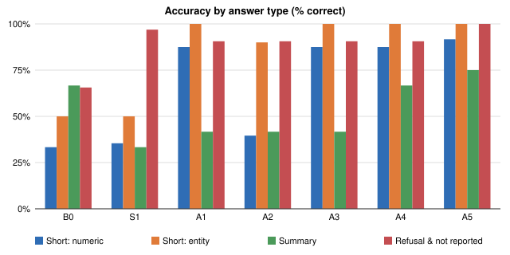
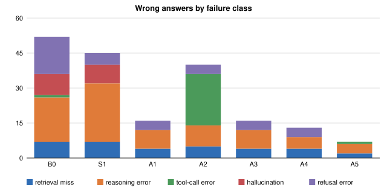
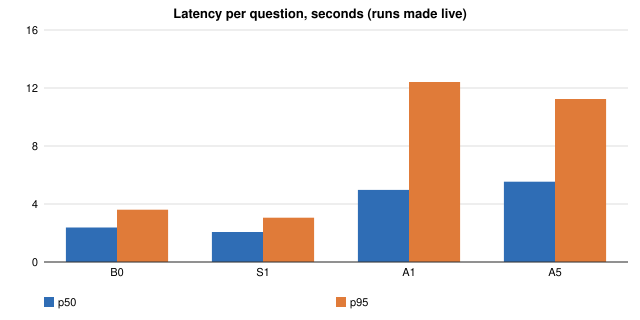

# Evaluation report

FinSight on the 102 questions of gold-v1 (80 gold questions and 22 refusal tests), every answer decided: numeric
and refusal answers by the W1-08 scorer, summaries, entity comparisons and every wrong answer by two human graders.
Everything below the line is generated by `python eval/report.py` from committed results (the scorer's
`eval/results/scores/`, the runs' metas and the traced runs); `python eval/report.py --check` fails when any table,
chart or the PDF (`eval/results/report/evaluation_report.pdf`) is stale, and the tests run it.

How to read it:
- **The versions** are the plan's path: B0 (one retrieval-augmented prompt), the best prompting strategy of S1-S3,
  A1 (the agent), the ablations A2-A4 (A1 with one component switched off) and A5 (the final version, W3-08).
- **Integrity.** The failure classes behind A5's fixes were found on A1's gold run, so every fix was a class-level
  change tuned on the development set v2 (new questions, none from gold), and A5 ran on gold once with its
  configuration pinned before the run (ADR-037). A1 stays the reported baseline; A5 is final because no answer type
  is worse than A1's.
- **The failure taxonomy** (the plan §9.3) is mapped from each wrong answer's failure label; `eval/report.py`'s
  docstring gives the mapping. A wrong line item counts as a retrieval miss only when the gold figures were not in
  what the run retrieved; the scorer checks that for numeric answers only, so a weak summary counts as a reasoning
  error.

<!-- GENERATED:START -->
### Versions

| Version | Run | What it is |
|---|---|---|
| B0 | `M1_qwen3-8b_rag_think-off_b0-v1` | single-shot RAG baseline |
| S1 | `S1_qwen3-8b_rag_think-off_s1-v1` | the best prompting strategy |
| A1 | `A1_qwen3-8b_agent_think-off_a-v1` | the agent |
| A2 | `A2_qwen3-8b_agent_think-off_a-v1-no-calculator` | A1, no calculator |
| A3 | `A3_qwen3-8b_agent_think-off_a-v1-no-critic` | A1, no critic |
| A4 | `A4_qwen3-8b_agent_think-off_a-v1-no-statements-first` | A1, no statements-first retrieval |
| A5 | `A5_qwen3-8b_agent_think-off_a-v1` | the final version (W3-08) |

### 1. Accuracy per version (correct answers / questions)

| Answer type | B0 | S1 | A1 | A2 | A3 | A4 | A5 |
|---|---|---|---|---|---|---|---|
| Short: numeric | 16/48 | 17/48 | 42/48 | 19/48 | 42/48 | 42/48 | 44/48 |
| Short: entity | 5/10 | 5/10 | 10/10 | 9/10 | 10/10 | 10/10 | 10/10 |
| Summary | 8/12 | 4/12 | 5/12 | 5/12 | 5/12 | 8/12 | 9/12 |
| Refusal & not reported | 21/32 | 31/32 | 29/32 | 29/32 | 29/32 | 29/32 | 32/32 |
| **All** | **50/102** | **57/102** | **86/102** | **62/102** | **86/102** | **89/102** | **95/102** |

### 2. Failure taxonomy of the wrong answers

| Failure class | B0 | S1 | A1 | A2 | A3 | A4 | A5 |
|---|---|---|---|---|---|---|---|
| retrieval miss | 7 | 7 | 4 | 5 | 4 | 4 | 2 |
| reasoning error | 19 | 25 | 8 | 9 | 8 | 5 | 4 |
| tool-call error | 1 | 0 | 0 | 22 | 0 | 0 | 1 |
| hallucination | 9 | 8 | 0 | 0 | 0 | 0 | 0 |
| refusal error | 16 | 5 | 4 | 4 | 4 | 4 | 0 |
| **wrong answers** | **52** | **45** | **16** | **40** | **16** | **13** | **7** |

### 3. Task completion, tool calls, retries and citations

| Measure | B0 | S1 | A1 | A2 | A3 | A4 | A5 |
|---|---|---|---|---|---|---|---|
| task completed (an answer contract, no error, within the limits) | 102/102 | 102/102 | 102/102 | 102/102 | 102/102 | 102/102 | 102/102 |
| tool calls per task (mean) | – | – | 1.63 | 1.29 | 1.63 | 1.63 | 1.67 |
| tool calls that returned an error | – | – | 4/166 | 4/132 | 4/166 | 4/166 | 5/170 |
| JSON retries per task (mean) | 0.00 | 0.00 | 0.00 | 0.00 | 0.00 | 0.00 | 0.00 |
| stopped by the step cap | – | – | 0/102 | 0/102 | 0/102 | 0/102 | 0/102 |
| verified by the critic | – | – | 102/102 | 77/102 | 0/102 | 101/102 | 98/102 |
| answers whose citations all name a source the run had | 74/74 | 72/72 | 81/81 | 81/81 | 81/81 | 81/81 | 82/82 |

### 4. Cost: tokens, latency and the reply cache

| Measure | B0 | S1 | A1 | A2 | A3 | A4 | A5 |
|---|---|---|---|---|---|---|---|
| tokens per question, mean | 3,536 | 4,546 | 3,000 | 3,654 | 3,000 | 3,024 | 3,419 |
| tokens per question, p50 | 3,516 | 4,522 | 2,817 | 2,805 | 2,817 | 2,817 | 3,210 |
| latency p50 (s) | 2.38 | 2.07 | 4.97 | – (replayed) | – (replayed) | – (replayed) | 5.54 |
| latency p95 (s) | 3.61 | 3.06 | 12.50 | – (replayed) | – (replayed) | – (replayed) | 11.24 |
| chat replies from the reply cache (when run) | 102/102 = 100% | 0/102 = 0% | 0/187 = 0% | 153/238 = 64% | 187/187 = 100% | 171/189 = 90% | 0/194 = 0% |

### 5. Traced runs (Langfuse)

| Run (tag run:<id>) | Questions | Replies | n | Verified | Refused | Seconds p50 | Tokens (mean) | Tool calls (mean) |
|---|---|---|---|---|---|---|---|---|
| `W3-09-demo-a5` | the 10 demo queries, A5 | live | 10 | 9 | 1 | 3.8 | 3,398 | 1.70 |
| `W3-09-a1-failures-a1` | A1's 16 wrong answers, A1's code | from the cache | 16 | 16 | 3 | – (cached) | 3,991 | 1.50 |
| `W3-09-a1-failures-a5` | the same 16 questions, A5 | from the cache | 16 | 13 | 2 | – (cached) | 4,652 | 1.81 |
<!-- GENERATED:END -->

## What it shows

- **The agent is the step change, A5 the refinement.** B0 answers 50 of 102 and the best prompting strategy 57; the
  agent answers 86, mostly by fetching figures from the facts tool and computing them with the calculator (short
  numeric 16/48 for B0, 42/48 for A1). A5 adds 9 more: three numeric answers (the facts tool's new metrics, W3-04),
  four summaries (the right MD&A section, W3-05) and three refusals (the rule priority and partial refusals, W3-06),
  less one numeric answer it lost (F02, a follow-up on Microsoft's operating margin answered with the operating
  income). Paired with B0 on the same questions, A5 is right where B0 is wrong 48 times and the reverse 3 times.
- **Which component carries the accuracy (ablations).** Without the calculator (A2) the agent falls from 86 to 62:
  22 answers become tool-call errors (several figures and no single computed value). Without the critic (A3) A1's
  answers do not change at all: A1's critic verified all 102 answers, the 16 wrong ones included, so switching it
  off cost nothing and caught nothing; W3-03 gave it deterministic checks, and A5's critic leaves 4 answers
  unverified, all four of them wrong. Without statements-first retrieval (A4) the agent answers 89, three summaries
  more; a likely reason is that statements-first retrieval favours the financial statements, which numeric
  questions need and summaries do not.
- **The failure classes move as the plan intended.** Hallucinations (numbers in no source) go from 9 (B0) to 0 for
  every agent version; refusal errors from 16 to 4 (A1) and 0 (A5); A5's 7 wrong answers are 2 retrieval misses,
  4 reasoning errors and 1 tool-call error.
- **What it costs.** A5 spends 3,419 tokens and 5.5 s (p50) a question, against A1's 3,000 tokens and 5.0 s, B0's
  3,536 tokens and 2.4 s. The agent is slower than one prompt because it makes about two model calls and 1.7 tool
  calls a question. The replayed runs (A2-A4, and the cache-only traced runs) have no comparable latency.

## Limits of these numbers

- **102 questions.** One answer is about 1 percentage point; the paired sign tests in
  `eval/results/agent_baselines.md` say which differences are more than chance (A5 against A1: none per type at
  p < 0.05, all decided answers 10 / 1, p = 0.01).
- **Citation accuracy** is measured as "every citation names a source the run was given or fetched" (the scorer's
  check), not as "the cited section contains the fact", which no committed file records per answer.
- **Task completion** is 102/102 for every version (an answer contract within the limits); it says the system
  answers, not that it answers right.
- **Gold-v1 was written by the team** from the same filings the corpus holds, and A1's failures shaped A5's fixes;
  the development set v2 and the one pinned gold run limit, but do not remove, that effect.

## The trace dashboard

Three traced runs in Langfuse (`scripts/trace_runs.py`, W3-09), each tagged `run:<id>`, every node, tool call and
model call a span with its latency and tokens, the question id a tag (`q:<id>`) so a failure is one click away:
- `W3-09-demo-a5`: the 10 demo queries on A5, live (16 chat requests, 5 replies from the cache).
- `W3-09-a1-failures-a1`: A1's 16 wrong answers on A1's own code (a worktree at commit 00cbfa7), replayed from the
  reply cache (no request): the answers are A1's, word for word.
- `W3-09-a1-failures-a5`: the same 16 questions on A5, from the cache (A5's gold run made those replies).

The tables `scripts/trace_dashboard.py` reads back from Langfuse are in `eval/results/traces/<run id>.md`. The
dashboard: the Langfuse project `finsight` (https://us.cloud.langfuse.com/project/cmwnz4frw017vad0e92ldh748/traces,
for the project's members), Tracing, filter `tags = run:<id>`. A cache-only run's seconds are the replay's, not a
user's wait.

The A1 table shows the finding behind W3-03: A1's critic verified 13 of its 16 wrong answers and flagged none of
them; the other three were refusals (RF10 and RF13 under the wrong rule, RF14 refused whole instead of answered in
part). The screenshots (`docs/screenshots/w3/`) follow one of them, B14, the AWS operating margin:
- `01_traces_a1_failures.png`: the run `W3-09-a1-failures-a1` in Langfuse, one trace per question.
- `02_trace_a1_b14_tree.png`: A1's trace for B14: planner, two facts, the calculator, composer, critic, finish,
  tagged `verdict:verified`, answering 10.8%.
- `03_trace_a1_b14_calculate.png`: the calculator's span: 68,593 / 637,959, Amazon's consolidated operating income
  over its total revenue, not AWS's segment figures (37.0%); A1 had no segment metric, and its critic passed it.
- `04_trace_a5_b14_critic.png`: A5 on the same question: still 10.8%, but its critic's segment check (W3-03) flags
  it ("the question is about a segment ... but the answer gives company totals") and the answer leaves unverified.
- `05_traces_demo_a5.png`: the run `W3-09-demo-a5`, the 10 demo queries on A5.
